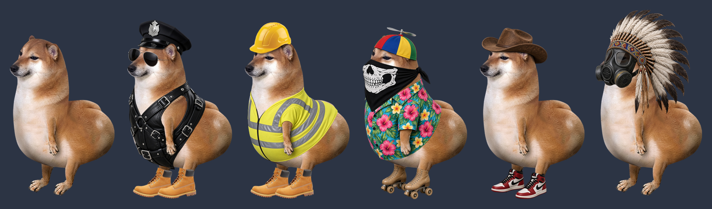

# Big Booty Cheems

A desktop buddy with a big jelly butt. Slap it, whip it, dress him up. He sits on your taskbar and wobbles.



A standalone Windows app. **No installer, no admin rights.**

## Features

- 🍑 A soft-body jelly butt that wobbles when slapped, carried, dropped or twerked
- ✋ Slap it by clicking, or by swiping the cursor across it fast like a real hand
- 🪃 Tools to whack it with: whip, cat o' nine tails, chancla, baseball bat and a wet fish. Pick one up, swing it, drop it anywhere.
- 👒 Mix-and-match outfits: headgear, face, top and shoes, which move with his body
- 😑 Blinks, breathes, sways, and screws his eyes shut when slapped
- 🔁 Random idles now and then (clench, twerk), never while you're busy with him
- 💩 Poke his belly 5 times quickly and... he sprays the wall
- 🔊 Real, low-latency slap sounds (a random take each time, louder the harder you hit)
- 🪶 One exe with everything built in
- 🔄 Built-in updater: *Check for updates...* in the menu fetches the latest release and swaps itself in place

## Download

Get **BigBootyCheems.exe** from the [latest release](../../releases/latest) and run it.

Windows SmartScreen may warn you the first time because the exe isn't code-signed. Click **More info → Run anyway**, or check it first (below).

## Usage

| Action | What happens |
|---|---|
| Click the butt | Slap |
| Swipe the cursor quickly across the butt | Slap (harder the faster you swipe) |
| Rest the cursor on the butt | It starts to thrust |
| Poke the belly 5 times quickly | 💩 |
| Left-drag | Move him (the butt lags behind and jiggles when you let go) |
| Right-click | Menu: headgear, face, top, shoes, tools, idle motion, random idles, check for updates, exit |
| Tools → pick one | It appears on the floor next to him. Press and hold to pick it up, swing, let go to drop. Pick it in the menu again to put it away. |

## Is it safe?

Treat any random exe from the internet with suspicion. This project tries to make checking easy:

- **The source is short and readable:** everything is in [`src/`](src).
- **It only goes online when you ask it to.** The one network feature is *Check for updates...* in the right-click menu. It contacts `api.github.com` for this repo's latest release and nothing else. It never checks on its own. An update is only installed if you click Yes, and only if the downloaded exe matches the SHA-256 hash published with the release.
- **No admin rights, no installer, no background services.**
- **It never reads your keyboard.** It only looks at where the mouse is.
- **It only writes one file:** its settings (which outfit you picked), in `%APPDATA%\BigBootyCheems\settings.ini`.
- **Releases are built by GitHub, not on anyone's PC.** The [Build workflow](.github/workflows/release.yml) compiles the exe from this source on GitHub's Windows machines. The build log is public.

### Verify a download

Each release includes `SHA256SUMS.txt`. In PowerShell:

```powershell
Get-FileHash .\BigBootyCheems.exe -Algorithm SHA256
```

The hash should match the one in `SHA256SUMS.txt`.

Releases also carry a signed build-provenance attestation. It proves the exe was built by this repo's workflow from a specific commit. To check it with the [GitHub CLI](https://cli.github.com/):

```powershell
gh attestation verify .\BigBootyCheems.exe --repo SnazzyGaz/BigBootyCheems
```

You can also upload the exe to [VirusTotal](https://www.virustotal.com/) yourself.

## Build it yourself

Windows 10 and 11 already include the C# compiler this needs, so there's nothing to install.

```bat
git clone https://github.com/SnazzyGaz/BigBootyCheems
cd BigBootyCheems
build.bat
```

The output is `dist\BigBootyCheems.exe`. Everything in `art\` (pictures and sounds) is embedded into the exe at build time.

### Adding clothes

Drop a PNG into `art\` with a slot prefix and rebuild:

- `Hat_<name>.png`, `Face_<name>.png`, `Top_<name>.png` or `Shoes_<name>.png`
- Draw it on the hero canvas (450×674), or on the clothes canvas (450×732, the hero sits 58 px down). Either works.
- For a two-frame animation, add `<name>2.png` alongside it (like the propeller hat).

## Uninstall

Right-click → *Exit*, then delete `BigBootyCheems.exe` and the `%APPDATA%\BigBootyCheems` folder.

## Credits

- App, clothing and tool art by MintyDoge.
- The Cheems photo is of Balltze, the Shiba Inu behind the meme.
- Slap sounds cut from ["Hand Clap / High Five / Realistic Slap"](https://freesound.org/people/olehenriksen/sounds/771247/) by olehenriksen (CC0).
- Fart and splat cut from ["Wet Fart"](https://freesound.org/people/james.luib/sounds/818387/) by james.luib (CC0).
- The code is MIT licensed (see [LICENSE](LICENSE)). The images and sounds in `art/` are **not** covered by the MIT licence.
